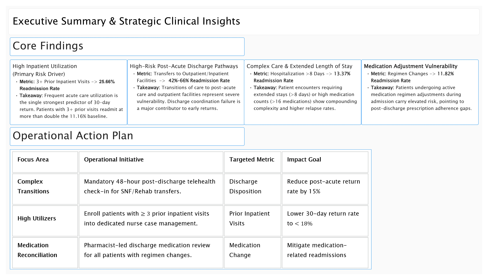
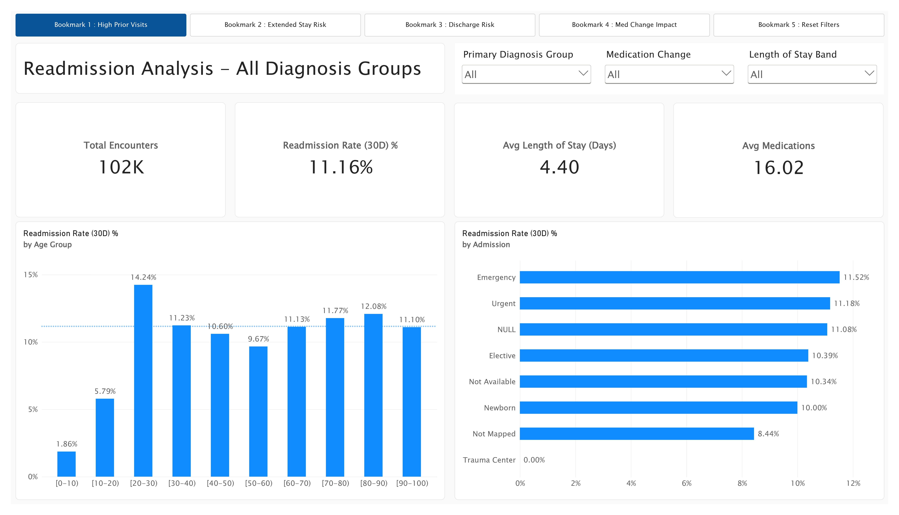
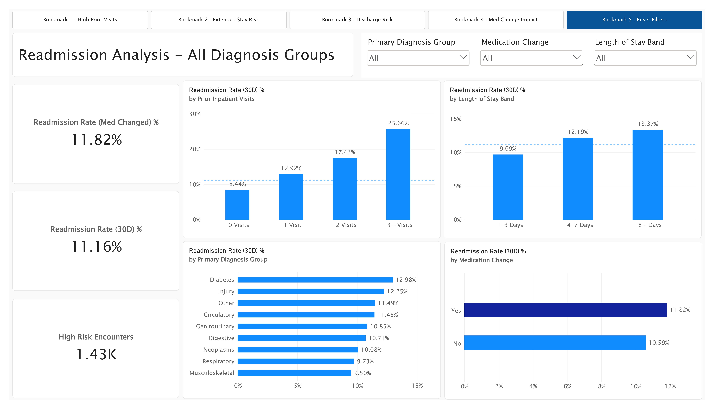
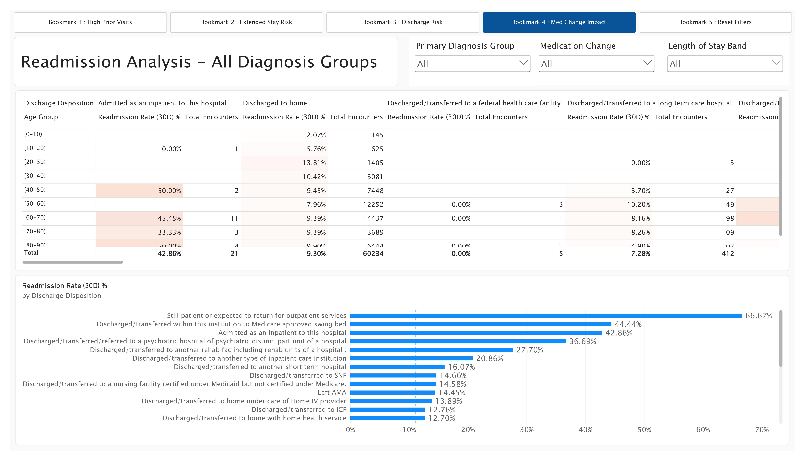
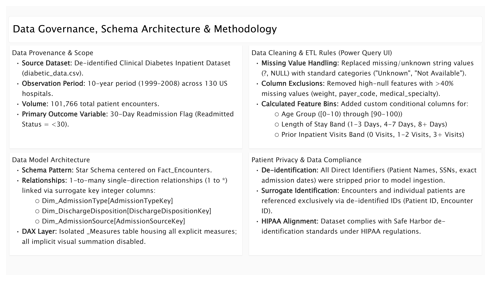
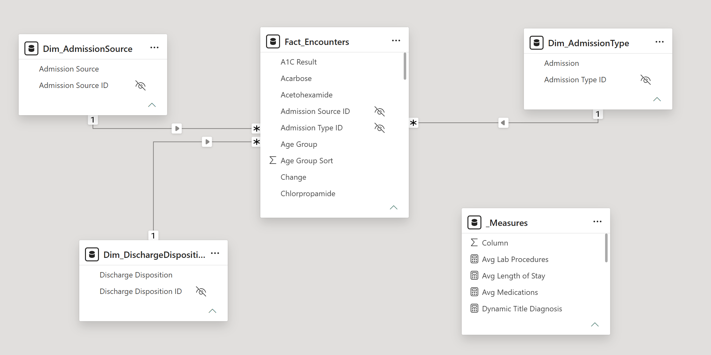

# 🏥 Hospital Readmission Insights — Clinical Data Analytics & BI Solution

[](https://powerbi.microsoft.com/)
[](https://learn.microsoft.com/en-us/dax/)
[](https://archive.ics.uci.edu/ml/datasets/Diabetes+130-US+hospitals+for+years+1999-2008)
[](#patient-privacy--data-governance)

---

## 📌 Executive Summary

Early hospital readmission within 30 days is a critical metric for healthcare quality and cost management. Unplanned readmissions increase hospital operating costs under value-based care penalties (such as the HRRP) and signal potential gaps in post-discharge care, care transitions, or medication adherence.

This project delivers an end-to-end Power BI analytical solution based on **10 years of clinical inpatient data (1999–2008) across 130 US hospitals** (~102,000 encounters). By modeling clinical attributes, hospitalization length, prior acute utilization, and medication changes, this business intelligence platform isolates key readmission drivers and equips clinical managers with an **Operational Action Plan** to mitigate 30-day return rates.

---

## 📑 Table of Contents
- [Executive Summary](#-executive-summary)
- [Key Performance Indicators (KPIs)](#-key-performance-indicators-kpis)
- [Dataset Provenance & Link](#-dataset-provenance--link)
- [Core Findings & Strategic Insights](#-core-findings--strategic-insights)
- [Operational Action Plan](#-operational-action-plan)
- [Dashboard Architecture & Interactive Modules](#-dashboard-architecture--interactive-modules)
  - [1. Readmission Overview](#1-readmission-overview)
  - [2. Primary Readmission Drivers](#2-primary-readmission-drivers)
  - [3. Discharge & Risk Segmentation](#3-discharge--risk-segmentation)
  - [4. Patient Encounter Details & Matrix](#4-patient-encounter-details--matrix)
  - [5. Executive Summary & Action Plan](#5-executive-summary--action-plan)
  - [6. Data Governance & Methodology](#6-data-governance--methodology)
- [Data Model & ETL Rules](#-data-model--etl-rules)
- [Repository Directory Structure](#-repository-directory-structure)
- [Setup & Usage Instructions](#-setup--usage-instructions)
- [Citation & Acknowledgments](#-citation--acknowledgments)

---

## 📊 Key Performance Indicators (KPIs)

| Metric | Baseline Value | Description |
| :--- | :--- | :--- |
| **Total Encounters** | **101,766 (102K)** | Total analyzed diabetic inpatient hospital admissions across 130 hospitals |
| **30-Day Readmission Rate** | **11.16%** | Primary target outcome ($<30$ days readmit flag) |
| **Avg Length of Stay (LOS)** | **4.40 Days** | Average hospitalization time per encounter |
| **Avg Medications Administered** | **16.02** | Average distinct medications prescribed per stay |
| **High Risk Encounters** | **1,430 (1.43K)** | Encounters with $\ge 3$ prior inpatient visits |

---

## 🔗 Dataset Provenance & Link

The underlying dataset is the **Diabetes 130-US Hospitals Dataset (1999–2008)**, hosted on the UCI Machine Learning Repository and Kaggle.

* **UCI Repository:** [UCI Machine Learning Repository — Diabetes 130-US Hospitals](https://archive.ics.uci.edu/ml/datasets/Diabetes+130-US+hospitals+for+years+1999-2008)
* **Kaggle Dataset:** [Kaggle — Diabetes 130 US Hospitals for Years 1999–2008](https://www.kaggle.com/datasets/brandao/diabetes)
* **Scope:** 101,766 inpatient encounters, 50+ clinical/demographic features.
* **Inclusion Criteria:** Inpatient admissions $\ge 1$ day and $\le 14$ days, diabetic diagnosis recorded, laboratory tests performed, and medications administered.

---

## 💡 Core Findings & Strategic Insights



### 1. High Inpatient Utilization (Primary Risk Driver)
* **Metric:** $3+$ Prior Inpatient Visits $\rightarrow$ **25.66% Readmission Rate**
* **Key Takeaway:** Frequent acute care utilization is the single strongest predictor of 30-day return. Patients with 3 or more prior visits readmit at **more than double** the baseline rate of $11.16\%$.
  * *0 Visits:* $8.44\%$
  * *1 Visit:* $12.92\%$
  * *2 Visits:* $17.43\%$
  * *3+ Visits:* $25.66\%$

### 2. High-Risk Post-Acute Discharge Pathways
* **Metric:** Discharge/Transfers to sub-acute or outpatient facilities $\rightarrow$ **$42\% - 66\%$ Readmission Rate**
* **Key Takeaway:** Transfers to post-acute care (e.g., swing beds, rehab facilities, or outpatient expectations) show critical post-discharge vulnerability, indicating care transition gaps.
  * *Expected return for outpatient services:* $66.67\%$
  * *Internal Medicare swing bed transfer:* $44.44\%$
  * *Inpatient transfer:* $42.86\%$
  * *Psychiatric hospital transfer:* $36.69\%$
  * *Rehab facility transfer:* $27.70\%$

### 3. Complex Care & Extended Length of Stay
* **Metric:** Hospitalization $>8$ Days $\rightarrow$ **13.37% Readmission Rate**
* **Key Takeaway:** Stays exceeding 8 days or involving high medication counts ($>16$ medications) reflect complex disease burden and compounding relapse potential.

### 4. Medication Adjustment Vulnerability
* **Metric:** Regimen Changes during admission $\rightarrow$ **11.82% Readmission Rate** (vs $10.59\%$ without changes)
* **Key Takeaway:** Patients undergoing active medication regimen updates during their stay carry elevated return risks, pointing to post-discharge medication adherence issues.

---

## 🖥️ Dashboard Architecture & Interactive Modules

The Power BI workbook (`Hospital Readmission Insights.pbix`) is organized into dedicated analytical modules with integrated **Bookmark Navigation**:

### 1. Readmission Overview
Provides macro-level visibility into total volume, baseline 30-day readmission rate, average length of stay, average medication count, age distribution, and admission types.



---

### 2. Primary Readmission Drivers
Breaks down readmission rates across key risk factors: Prior Inpatient Visits, Length of Stay Bands ($1\text{--}3$ Days, $4\text{--}7$ Days, $8+$ Days), Primary Diagnosis Groups, and Medication Changes.



---

### 3. Discharge & Risk Segmentation
Matrix cross-tabulation comparing Discharge Disposition pathways against Patient Age Groups, alongside a distribution bar chart highlighting high-risk discharge destinations.



---

### 4. Patient Encounter Details & Matrix
Granular record-level table view alongside a quad-scatter analysis (**Avg Medications** vs **Avg Length of Stay** grouped by Diagnosis).


---

### 5. Executive Summary & Action Plan
Consolidates core clinical takeaways and maps them directly to targeted operational initiatives.


---

### 6. Data Governance & Methodology
Documents data provenance, transformation logic, privacy compliance, and dimensional star schema design.



---

## 🏗️ Data Model & ETL Rules



### Schema Pattern: Star Schema
The model is anchored on `Fact_Encounters` and surrounded by key single-direction ($1 \rightarrow *$) dimension tables linked via surrogate keys:
* `Dim_AdmissionType` $[ \text{AdmissionTypeKey} ] \rightarrow \text{Fact\_Encounters}[ \text{Admission Type ID} ]$
* `Dim_DischargeDisposition` $[ \text{DischargeDispositionKey} ] \rightarrow \text{Fact\_Encounters}[ \text{Discharge Disposition ID} ]$
* `Dim_AdmissionSource` $[ \text{AdmissionSourceKey} ] \rightarrow \text{Fact\_Encounters}[ \text{Admission Source ID} ]$
* `_Measures`: Isolated DAX container table housing all explicit measures (implicit visual summation disabled).

### Data Cleaning & Power Query ETL Transformations
1. **Missing Value Handling:** String missing indicators (`?`, `NULL`) replaced with standard categories (`"Unknown"`, `"Not Available"`).
2. **High-Null Column Exclusions:** Removed features with $>40\%$ missing values (`weight`, `payer_code`, `medical_specialty`).
3. **Calculated Feature Bins:**
   * **Age Group:** $[0\text{--}10)$ through $[90\text{--}100)$
   * **Length of Stay Band:** `1-3 Days`, `4-7 Days`, `8+ Days`
   * **Prior Inpatient Visits Band:** `0 Visits`, `1-2 Visits`, `3+ Visits`

### Patient Privacy & Data Governance
* **De-identification:** All direct identifiers (Patient Names, SSNs, exact admission dates) were stripped prior to model ingestion.
* **HIPAA Alignment:** Dataset complies with **Safe Harbor** de-identification standards under HIPAA regulations.

---

## 📁 Repository Directory Structure

```text
Hospital Readmission Insights/
├── data/
│   ├── diabetic_data.csv          # Raw de-identified clinical dataset (101,766 encounters)
│   └── IDS_mapping.csv           # Code mappings for admission, discharge, and source IDs
├── docs/
│   └── Hospital Readmission Insights.pdf # Executive presentation export
├── images/
│   ├── about.jpg                  # Data Governance & Methodology UI
│   ├── action_plan.png            # Operational Action Plan breakdown
│   ├── driver.jpg                 # Readmission Drivers visual module
│   ├── insights.jpg               # Executive Insights & Takeaways view
│   ├── model.png                  # Power BI Data Model Star Schema
│   ├── overview.jpg               # Readmission Overview visual module
│   ├── patient details.jpg        # Granular Patient Matrix & Scatter Plot
│   └── segment.jpg                # Discharge & Risk Segmentation matrix
├── pbix/
│   └── Hospital Readmission Insights.pbix # Interactive Power BI Desktop Report
└── README.md                      # Project documentation
```

---
